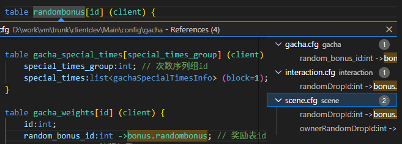

##  快速开始

1. ** 安装扩展**：在 VSCode 扩展商店中搜索 "cfg-support" 并安装
2. ** 打开 CFG 文件**：打开任何 `.cfg` 文件

##  功能特性

###  语法高亮
- **结构定义高亮**：`struct`、`interface`、`table` 名称
- **类型标识符高亮**：自定义类型名称（非基础类型）
- **外键引用高亮**：普通表引用、`->::machines.phases`、`->@Machine::phases`、混合来源与 `index` 等新语法
- **元数据关键字高亮**：`nullable`、`mustFill`、`enumRef` 等
- **主键字段高亮**：在表定义中的主键字段

###  跳转到定义
- **类型跳转**：Ctrl+点击类型名称跳转到其定义
- **外键跳转**：Ctrl+点击外键引用跳转到目标表
- **接口内跳转**：在接口内部定义的 struct 优先在当前接口内查找
- **内部引用导航**：跨 record 的目标表、每个 `@Type` 祖先类型和 `@Interface.Impl` 实现都可以分别跳转；类型和表按各自命名空间解析

内部路径的字段段会正确着色，当前版本没有逐段字段跳转；不会将字段误跳转到同名表。未保存编辑和撤销后，高亮与导航使用当前文档内容。

###  大纲视图
- **结构导航**：使用大纲视图快速浏览文件结构
- **层级展示**：清晰显示接口、结构、表的层级关系

###  查找引用
- **引用查找**：右键点击类型或表名选择"查找所有引用"
- **跨文件分析**：支持分析整个项目的引用关系
    
